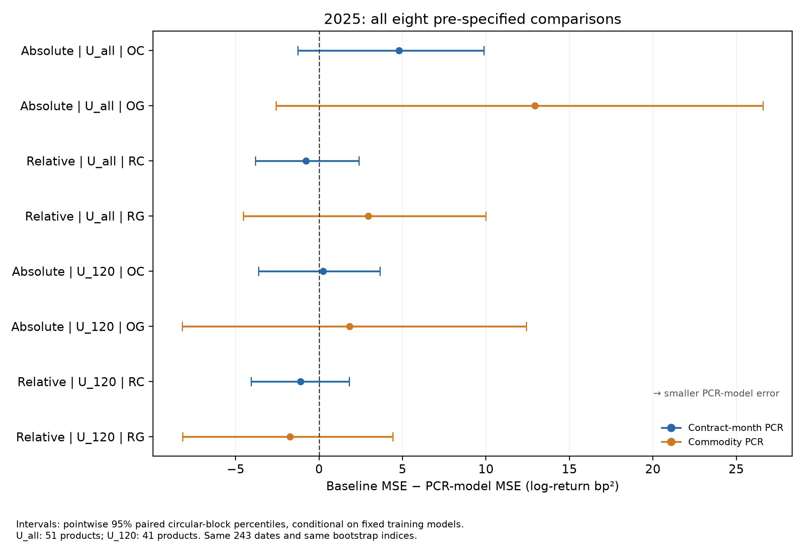

# OptionFlow

[English](README.md) | [简体中文](README.zh-CN.md)

### Option Activity and Commodity Futures Returns

**Does today's option activity contain information about tomorrow's commodity futures return?**

OptionFlow studies put–call ratios using official option and futures data from five Chinese commodity exchanges. It combines contract-aware data construction, panel inference, and a fixed-model historical holdout evaluation. PCR here uses daily volume or open interest without identifying buyer- or seller-initiated order flow.

**Main finding:** the prespecified daily linear models show no clear next-day predictive evidence. All eight primary 2025 comparisons have intervals spanning zero for incremental forecast accuracy relative to their no-PCR benchmarks. Some contemporaneous associations are stronger; those are a different question.



Each row is one prespecified comparison. *Absolute* means the signed raw next-day log price return; *Relative* means the return demeaned within the evaluation universe and date. OC/OG (RC/RG) add contract-month or commodity-level PCR to the no-PCR benchmark O0 (R0). U_all contains 51 products; U_120 contains 41 products with at least 120 development rows. Bars are pointwise 95% circular-block intervals. Values to the right of zero mean lower PCR-model squared error. The comparisons share dates and resampling indices, and the universes overlap.

## Study at a glance

| Item | Scope |
|---|---|
| Exchanges | DCE, CZCE, SHFE, INE and GFEX |
| Official source files | 588 historical downloads; underlying coverage 2017–2025 |
| Core panel | 43,079 commodity-days across 61 products, 2019–2025 |
| Development sample | 30,377 observations across 52 products, 2019–2024 |
| Historical evaluation | 2025; 51 previously observed products / 12,039 rows |
| Parallel evaluation subset | 41 products with at least 120 development observations / 9,692 rows |
| Core inference | Commodity and outcome-date fixed effects; two-way clustering; Holm adjustment |
| Forecast uncertainty | Paired 20-day circular blocks; 10,000 resamples |

The 61 products form an unbalanced panel: contracts enter as matching option and futures observations become available. The futures contract is selected by same-day activity before option and outcome availability is checked. Next-day returns keep that contract identity even when the most active month changes.

## Read the study

- [Full results](reports/RESULTS.md) and [methods](reports/METHODS.md) — complete English reports with [Chinese results](reports/RESULTS.zh-CN.md) and [Chinese methods](reports/METHODS.zh-CN.md).
- [Data and construction rules](docs/DATA.md) and [data dictionary](docs/DATA_DICTIONARY.md) ([Chinese dictionary](docs/DATA_DICTIONARY.zh-CN.md)).
- [Study design](config/study_design.json), [table index](reports/TABLE_INDEX.md), and [method references](reports/REFERENCES.md).
- [Historical holdout disclosure](reports/HOLDOUT_DISCLOSURE.md) and [reproducibility scope](docs/REPRODUCIBILITY.md).

## Run the public checks

The aggregate-result verification uses only the Python standard library:

```bash
python scripts/verify_release.py
```

To use the numerical core and run synthetic tests with Python 3.12:

```bash
python -m pip install -e .
python -m unittest discover -s tests -v
```

`optionflow.estimation` implements fixed-effect estimation, two-way clustered covariance, Holm adjustment, fixed-effect recovery and restricted wild bootstrap. `optionflow.scoring` implements separate within-universe centering, loss aggregation and paired circular-block evaluation. The public package exposes these numerical components and reviewed aggregate outputs; it does not bundle the complete exchange ingestion and private audit environment.

## Data and interpretation

Raw downloads, contract-level research panels and row-level predictions are not distributed here. The release contains study documentation, numerical code, model parameters and aggregate results. Full empirical reconstruction requires separately obtained inputs and the data construction described in the methods.

This is a retrospective holdout assessment with disclosed data exposure: the 2025 inputs were processed before scoring. Models and scoring rules were fixed locally before their errors were evaluated; there was no public preregistration, and this repository was created after evaluation. Earlier analyses used overlapping 2019–2024 development data, without 2025. The 2025 period has now been used and cannot serve as a fresh test set for further model selection.

The target is a close-to-close price return. The study does not estimate implementable trading profits, costs, slippage or a causal effect of sentiment. Its findings concern the tested specifications and sample.

## Contributions and AI assistance

Yichen Wang coordinated this study and was responsible for defining the research question, collecting the 588 official source files, making key data and evaluation decisions, organizing staged reviews, and reviewing the final results. ChatGPT and Claude assisted with research-design discussions, code implementation, independent computational checks and manuscript preparation. See the [reproducibility scope](docs/REPRODUCIBILITY.md) for the scope of AI use, the computational review process and its limitations, and the frozen configuration's provenance.

## License

Code is covered by the [MIT license](LICENSE). Original documentation and aggregate research outputs are covered by [CC BY 4.0](LICENSE-DOCS.md), to the extent rights are held by the author. These licenses do not cover exchange inputs or third-party material; raw data are not distributed.

## Author

[Yichen Wang (Ethan)](https://github.com/ethan-yichen-wang) · Nanyang Technological University, Singapore
