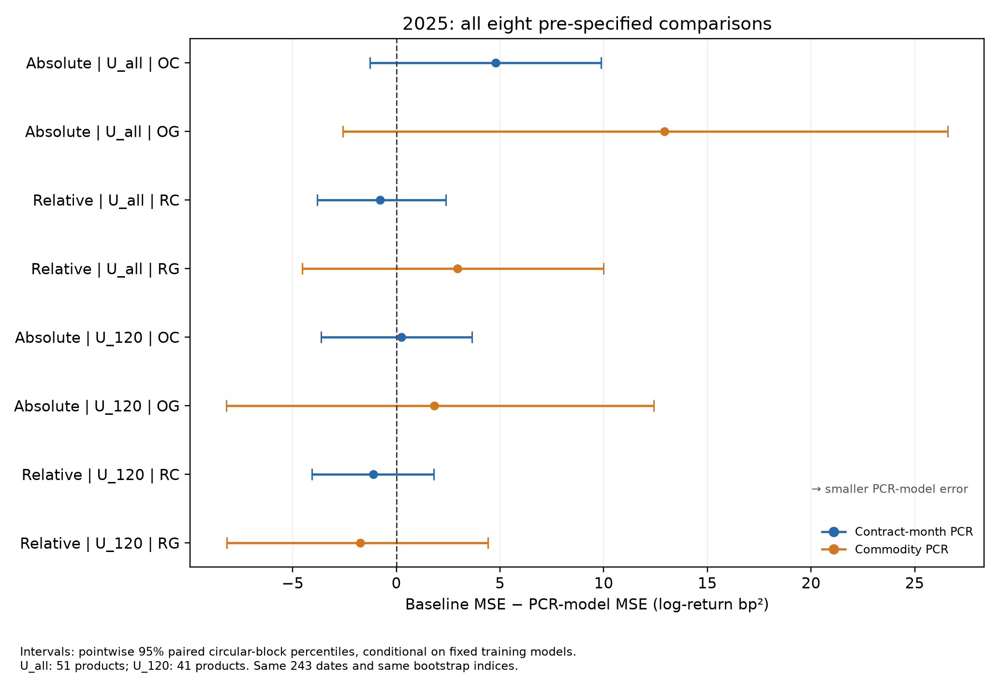

# OptionFlow

[English](README.md) | [简体中文](README.zh-CN.md)

### 期权交易活动与商品期货收益

**当天的期权活动，能否提供关于下一交易日商品期货收益的信息？**

OptionFlow基于中国五个商品交易所的官方期权及期货数据，研究看跌/看涨比率（PCR），结合严格的合约匹配、面板推断与固定模型的历史留出评估。这里的PCR使用每日成交量或持仓量，不区分买方或卖方主动发起的订单流。

**主要发现：**预定的日频线性规格没有显示明确的次日预测证据。2025年八个主要比较相对于各自无PCR基准的预测精度差异区间均跨0。部分同期关联更强，但回答的是另一类问题。



每行是一项预先设定的比较。图中Absolute指带正负号的原始次日对数价格收益，Relative指在评估集合及日期内去均值后的收益。OC/OG（RC/RG）分别在无PCR基准O0（R0）中加入合约月份或商品口径PCR。U_all含51个品种，U_120含开发期至少120行的41个品种。横线为逐项95%循环区块区间；零右侧表示PCR模型的平方误差较低。各项共享日期和重抽索引，两个集合存在重叠。

## 研究概况

| 项目 | 范围 |
|---|---|
| 交易所 | DCE、CZCE、SHFE、INE、GFEX |
| 官方来源 | 588份历史下载文件；基础数据覆盖2017—2025 |
| 核心面板 | 2019—2025，61品种，43,079个商品日 |
| 开发样本 | 2019—2024，52品种，30,377行 |
| 历史评估 | 2025年，开发期已见的51品种，12,039行 |
| 并列评估子集 | 开发期至少120行的41品种，9,692行 |
| 主要推断 | 商品与收益日固定效应、双向聚类、Holm校正 |
| 预测区间 | 成对20交易日循环区块，10,000次重抽 |

61个品种组成非平衡面板，随对应期权和期货数据变得可用而进入样本。先按当日成交量选择期货合约，再检查期权和收益可用性；次日主力变更时，收益目标仍使用信号日选定的同一合约。

## 阅读入口

- [中文结果报告](reports/RESULTS.zh-CN.md)、[中文方法](reports/METHODS.zh-CN.md)；[英文结果](reports/RESULTS.md)、[英文方法](reports/METHODS.md)。
- [数据构造规则](docs/DATA.zh-CN.md)、[中文数据字典](docs/DATA_DICTIONARY.zh-CN.md)、[研究配置](config/study_design.json)。
- [中文表格索引](reports/TABLE_INDEX.zh-CN.md)、[中文参考文献说明](reports/REFERENCES.zh-CN.md)。
- [留出期接触说明](reports/HOLDOUT_DISCLOSURE.zh-CN.md)、[复现范围](docs/REPRODUCIBILITY.zh-CN.md)。

## 运行公开检查

汇总结果与文件指纹核验只需Python标准库：

```bash
python scripts/verify_release.py
```

在Python 3.12环境使用数值模块及合成数据测试：

```bash
python -m pip install -e .
python -m unittest discover -s tests -v
```

`optionflow.estimation`包含固定效应、双向聚类、Holm调整、固定效应恢复和受限wild bootstrap；`optionflow.scoring`包含各集合单独去均值、损失汇总和成对循环区块评估。公开包提供数值核心与已核对的汇总结果，没有打包完整交易所数据接入及私有审核环境。

## 数据与解释边界

原始下载、逐合约研究面板和逐行预测不在本仓库分发。公开内容为研究说明、数值代码、模型参数及汇总结果。完整实证重建需要另外获得输入，并按方法说明构造数据。

2025年输入在评分之前已经过预处理，这是披露数据接触条件下的历史留出评估。模型与评分规则在误差评估前于本地固定，未作公开预注册，仓库在评分完成后创建。更早的分析使用过重叠的2019—2024年开发期数据，但未包含2025年。2025年已经使用，不能再作为进一步模型选择的新测试集。

目标是相邻收盘价格的收益变化；本研究未估计可执行交易利润、成本、滑点或情绪的因果效应。结论限于已检验的规格与样本。

## 作者贡献与AI辅助

王奕晨提出研究问题、收集588份官方来源文件、批准关键数据与评估决策，并对最终解释负责。ChatGPT与Claude辅助完善设计、实现代码、独立重实现、计算核对和文稿撰写。这些核对属于AI辅助的计算审核，并非外部同行评审。详见[复现范围](docs/REPRODUCIBILITY.zh-CN.md)，其中也说明冻结配置的来源。

## 许可证

代码采用[MIT许可证](LICENSE)。作者拥有权利的原创文档与汇总研究成果采用[CC BY 4.0](LICENSE-DOCS.md)。授权不覆盖交易所输入或第三方材料；本仓库不分发原始数据。

## 作者

[Yichen Wang（Ethan）](https://github.com/ethan-yichen-wang) · 新加坡南洋理工大学
